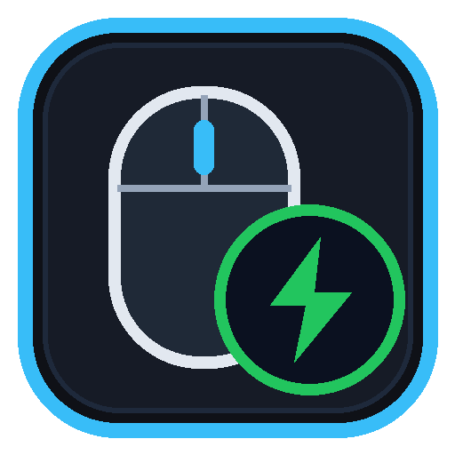
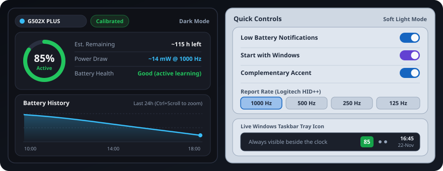

<div align="center">



# Mouse Battery & Control

**Know your wireless mouse battery at a glance — right by the Windows clock.**

[Website](https://aleksa75.github.io/mouse-battery-control/) &bull; [Download v3.0.0 (.exe)](https://github.com/Aleksa75/mouse-battery-control/releases/latest/download/MouseBatteryControl.exe) &bull; [All Releases](https://github.com/Aleksa75/mouse-battery-control/releases)

</div>

---



## What Is This For?

Wireless mice are great until they die in the middle of a call or game. **Mouse Battery & Control** is an ultra-lightweight, ad-free Windows tray app built in **native Rust + lazy Edge WebView2** (just **492 KB**, ~**2.5 MB** idle private RAM) without installing heavy driver suites:

- **See your exact battery percentage anytime** in the Windows system tray next to the clock.
- **Know how much time is actually left** — the app learns from your real active usage instead of guessing wildly.
- **Get notified before it's too late** with native Windows alerts when battery drops low or won't last until evening.
- **Tweak mouse settings in seconds** without digging through Windows menus (plus live DPI, polling rate, LIGHTSYNC RGB, and onboard profiles for Logitech wireless mice).

## Key Features

| Feature | What it gives you |
| :--- | :--- |
| **Ultra-Light Native Tray Badge** | Color-coded battery percentage in the taskbar tray (~2.5 MB idle RAM; the WebView2 UI completely unloads when closed to tray). |
| **Smart Forecast & Battery Health** | Tracks real active-use drain, plots unstretched zoomable (`24h`/`7d`/`30d`) battery history, and shows an experimental battery health estimate over cycles. |
| **Timely Windows Notifications** | Alerts you at customizable low/critical levels or when remaining charge won't reach your evening cutoff. |
| **Mouse & Logitech Controls** | Pointer speed, scroll speed, button swap, and auto game acceleration toggle for **any mouse** — plus live DPI, report rate (`125–1000 Hz`), LIGHTSYNC RGB, and onboard profile controls for Logitech HID++ 2.0 mice. Battery tracking works with Logitech wireless mice (G HUB / direct HID++) and Bluetooth/BLE mice exposing the Windows GATT Battery Service; generic wired/USB mice get pointer controls only. |
| **Themes & Complementary Accents** | Dark, Light, Matrix, and Windows System modes, Windows accent & complementary accent pairing, drag-to-reorder tabs, and full **English / Russian** switch. |
| **Standalone, Portable & Private** | Single **492 KB** `MouseBatteryControl.exe` with zero temp unpacking or runtime bloat, atomic JSON preference export/import, live memory & idle-time diagnostics, and strictly opt-in online mouse icon lookup (off by default). |

## How to Download & Install (15 Seconds)

No installer wizard, ZIP extraction, or Python/runtime setup needed:

1. **Download** [`MouseBatteryControl.exe`](https://github.com/Aleksa75/mouse-battery-control/releases/latest/download/MouseBatteryControl.exe) (**492 KB**) and [`SHA256SUMS.txt`](https://github.com/Aleksa75/mouse-battery-control/releases/latest) from the [Latest Release](https://github.com/Aleksa75/mouse-battery-control/releases/latest).
2. **Verify & Place:** Optional (recommended before running): verify the binary checksum with `Get-FileHash MouseBatteryControl.exe -Algorithm SHA256` against `SHA256SUMS.txt`. Move `MouseBatteryControl.exe` into a permanent folder such as `Documents\MouseBatteryControl` (where it stores `config.json` and `history.jsonl`).
3. **Double-click `MouseBatteryControl.exe`** to open the app and place the battery badge in your system tray. Closing the window minimizes to the tray and unloads the UI renderer automatically.
4. *(Optional)* Open **Notifications** &rarr; turn on **Start with Windows** so it starts automatically when you turn on your PC.

> [!NOTE]
> **First-time launch on Windows?** Because this is a free personal utility without a paid Microsoft developer certificate, Windows Defender SmartScreen may show *"Windows protected your PC"* the first time you open it. Verify the file came from the official GitHub Release (and matches `SHA256SUMS.txt`), then click **More info** &rarr; **Run anyway**.

## Updates

Update checking against **GitHub Releases** is built in out of the box (`github:Aleksa75/mouse-battery-control`). Click **Check for Updates** in the **Sync & Backup** tab to check for a newer release and open the download page directly.

---

<details>
<summary><strong>For Developers: Build v3.0.0 (Rust) or Legacy Python from Source</strong></summary>

### Build Native Rust v3.0.0 Binary (`rust_app/`)

Requires **Windows 10 / 11 (64-bit)**, **Visual Studio Build Tools (`vcvars64.bat`)**, and **`rustc` (Edition 2021)** — zero external Cargo crate dependencies:

```cmd
cd rust_app
build.cmd test
build.cmd
```

This compiles `rust_app\MouseBatteryControl.exe` with embedded resources (`app.rc`) and runs cleanly with `MouseBatteryControl.exe --smoke-test`.

- `rust_app/src/main.rs` — Win32 tray host, lazy Edge WebView2 lifecycle, state loop & unit tests
- `rust_app/src/wv2.rs` — Direct COM bindings for `EmbeddedBrowserWebView.dll`
- `rust_app/src/monitor.rs` — Logitech G HUB SQLite & HID++ battery reader, active-time carry-forward, drain forecasting & WinRT toast alerts
- `rust_app/src/hidpp.rs` — Native `hid.lib` / `setupapi.lib` Logitech HID++ 2.0 protocol (DPI, polling rate, LIGHTSYNC RGB, onboard/host mode)
- `rust_app/src/mouse.rs` — Win32 pointer speed, acceleration, scroll lines, button swap, idle time, foreground game detection & Windows accent/theme readers
- `rust_app/src/config.rs` & `rust_app/src/json.rs` — Atomic JSON persistence (`MoveFileExW`), schema validation & RFC 8259 JSON parser
- `rust_app/src/updater.rs` — Native `winhttp.lib` + `bcrypt.lib` GitHub Release checker & SHA-256 helper
- `rust_app/src/ui.html` — WebView2 dashboard, zoomable history chart, mouse & HID++ controls, backup & diagnostics
- `docs/` — Source for the [GitHub Pages site](https://aleksa75.github.io/mouse-battery-control/)

<details>
<summary>Legacy Python v2.30.0 Source (kept in repository root)</summary>

Requires **Windows 10 / 11 (64-bit)** and **Python 3.12+**:

```powershell
python -m venv .venv
.venv\Scripts\activate
pip install -r requirements.txt
python tray_app.py
```

</details>

</details>
